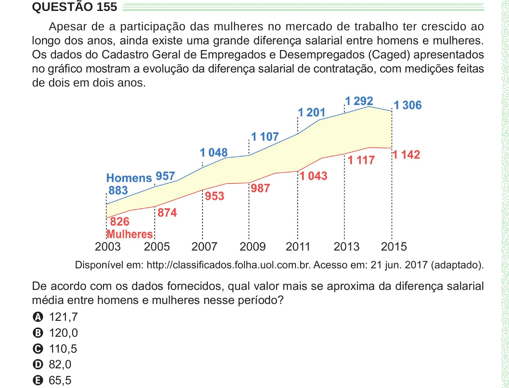

Texto extraído (pode conter ruído)

QUESTÃO 155  
Apesar de a participação das mulheres no mercado de trabalho ter crescido ao  
longo dos anos, ainda existe uma grande diferença salarial entre homens e mulheres.  
Os dados do Cadastro Geral de Empregados e Desempregados (Caged) apresentados  
no gráfico mostram a evolução da diferença salarial de contratação, com medições feitas  
de dois em dois anos.  
Disponível em: http://classificados.folha.uol.com.br. Acesso em: 21 jun. 2017 (adaptado).  
De acordo com os dados fornecidos, qual valor mais se aproxima da diferença salarial  
média entre homens e mulheres nesse período?  
A 121,7  
B 120,0  
C 110,5  
D 82,0  
E 65,5

