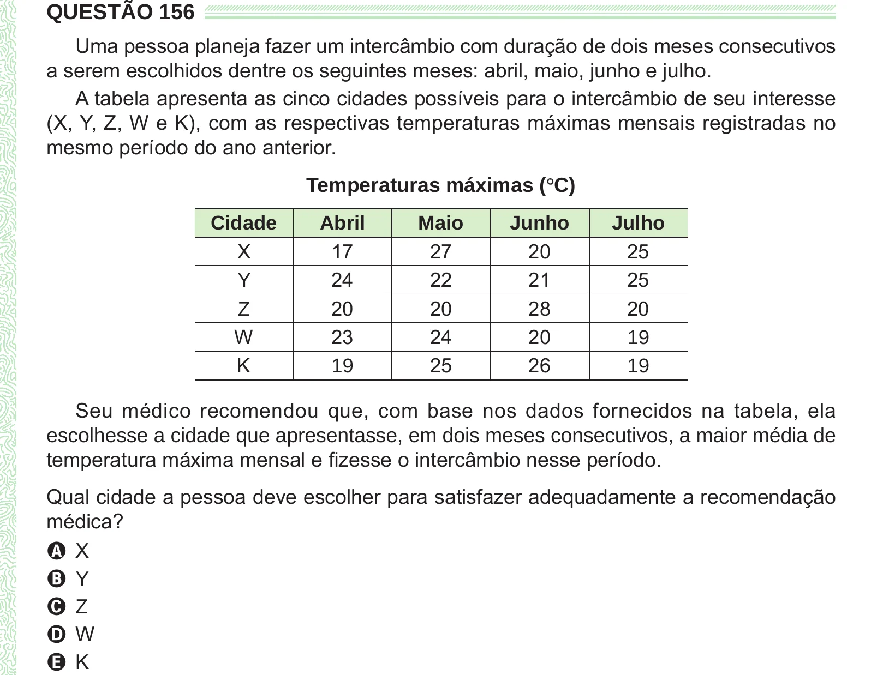

Texto extraído (pode conter ruído)

QUESTÃO 156  
Uma pessoa planeja fazer um intercâmbio com duração de dois meses consecutivos  
a serem escolhidos dentre os seguintes meses: abril, maio, junho e julho.  
A tabela apresenta as cinco cidades possíveis para o intercâmbio de seu interesse  
(X, Y, Z, W e K), com as respectivas temperaturas máximas mensais registradas no  
mesmo período do ano anterior.  
Temperaturas máximas (°° C)  
Cidade  
Abril  
Maio  
Junho  
Julho  
X  
17  
27  
20  
25  
24  
22  
21  
25  
Y  
20  
20  
28  
20  
Z  
W  
23  
24  
20  
19  
K  
25  
26  
19  
19  
Seu médico recomendou que, com base nos dados fornecidos na tabela, ela  
escolhesse a cidade que apresentasse, em dois meses consecutivos, a maior média de  
temperatura máxima mensal e fizesse o intercâmbio nesse período.  
Qual cidade a pessoa deve escolher para satisfazer adequadamente a recomendação  
médica?  
A X  
B Y  
C Z  
D W  
E K

