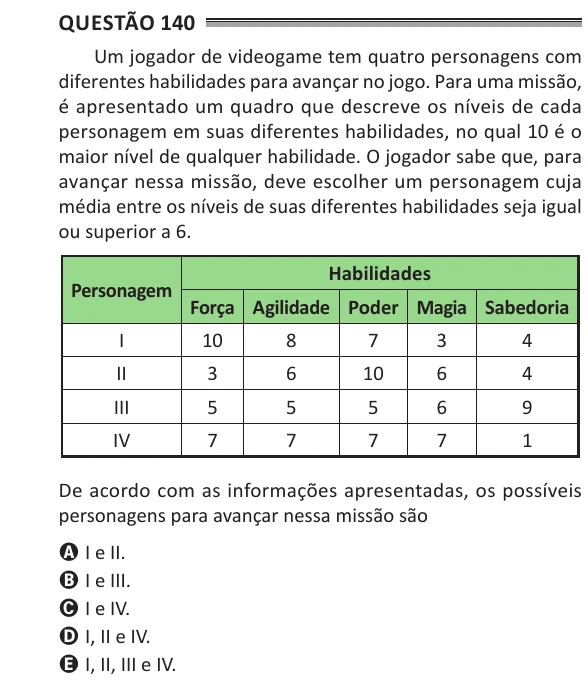

Texto extraído (pode conter ruído)

Questão 140  
Um jogador de videogame tem quatro personagens com  
diferentes habilidades para avançar no jogo. Para uma missão,  
é apresentado um quadro que descreve os níveis de cada  
personagem em suas diferentes habilidades, no qual 10 é o  
maior nível de qualquer habilidade. O jogador sabe que, para  
avançar nessa missão, deve escolher um personagem cuja  
média entre os níveis de suas diferentes habilidades seja igual  
ou superior a 6.  
Habilidades  
Personagem  
Força Agilidade Poder Magia sabedoria  
I  
10  
8  
7  
3  
4  
II  
3  
6  
10  
6  
4  
III  
5  
5  
5  
6  
9  
IV  
7  
7  
7  
7  
1  
De acordo com as informações apresentadas, os possíveis  
personagens para avançar nessa missão são  
A I e II.  
B I e III.  
C I e IV.  
D I, II e IV.  
E I, II, III e IV.

