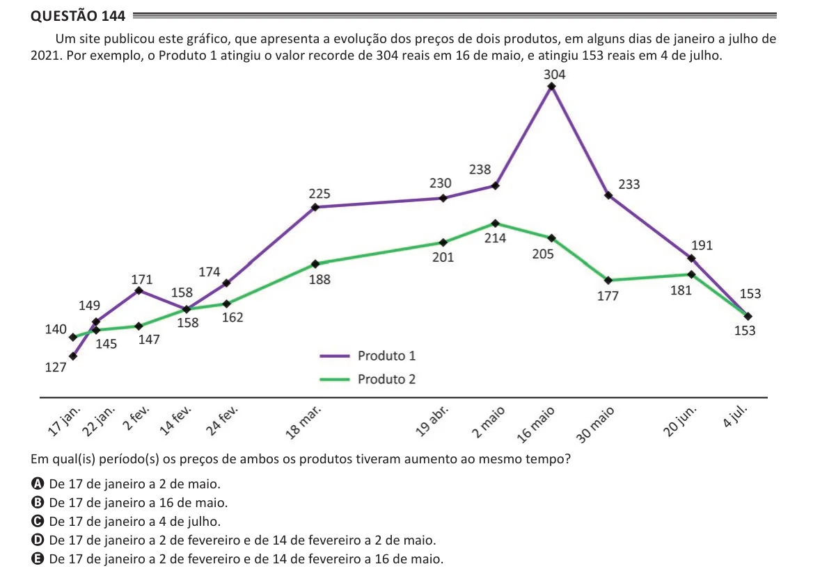

Texto extraído (pode conter ruído)

Questão 144  
Um site publicou este gráfico, que apresenta a evolução dos preços de dois produtos, em alguns dias de janeiro a julho de  
2021. Por exemplo, o Produto 1 atingiu o valor recorde de 304 reais em 16 de maio, e atingiu 153 reais em 4 de julho.  
Em qual(is) período(s) os preços de ambos os produtos tiveram aumento ao mesmo tempo?  
A De 17 de janeiro a 2 de maio.  
B De 17 de janeiro a 16 de maio.  
C De 17 de janeiro a 4 de julho.  
D De 17 de janeiro a 2 de fevereiro e de 14 de fevereiro a 2 de maio.  
E De 17 de janeiro a 2 de fevereiro e de 14 de fevereiro a 16 de maio.

