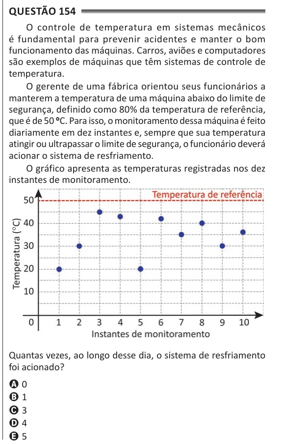

Texto extraído (pode conter ruído)

Questão 154  
O controle de temperatura em sistemas mecânicos  
é fundamental para prevenir acidentes e manter o bom  
funcionamento das máquinas. Carros, aviões e computadores  
são exemplos de máquinas que têm sistemas de controle de  
temperatura.  
O gerente de uma fábrica orientou seus funcionários a  
manterem a temperatura de uma máquina abaixo do limite de  
segurança, definido como 80% da temperatura de referência,  
que é de 50 ° C. Para isso, o monitoramento dessa máquina é feito  
diariamente em dez instantes e, sempre que sua temperatura  
atingir ou ultrapassar o limite de segurança, o funcionário deverá  
acionar o sistema de resfriamento.  
O gráfico apresenta as temperaturas registradas nos dez  
instantes de monitoramento.  
Quantas vezes, ao longo desse dia, o sistema de resfriamento  
foi acionado?  
A 0  
B 1  
C 3  
D 4  
E 5

