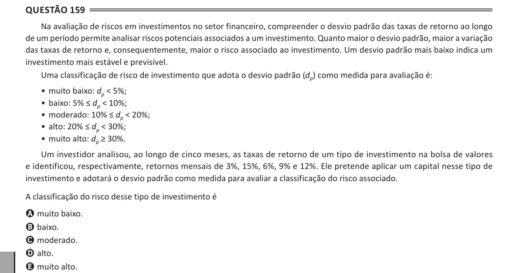

Texto extraído (pode conter ruído)

Questão 159  
Na avaliação de riscos em investimentos no setor financeiro, compreender o desvio padrão das taxas de retorno ao longo  
de um período permite analisar riscos potenciais associados a um investimento. Quanto maior o desvio padrão, maior a variação  
das taxas de retorno e, consequentemente, maior o risco associado ao investimento. Um desvio padrão mais baixo indica um  
investimento mais estável e previsível.  
Uma classificação de risco de investimento que adota o desvio padrão (d p ) como medida para avaliação é:  
• muito baixo: d p < 5%;  
• baixo: 5% ≤ d p < 10%;  
• moderado: 10% ≤ d p < 20%;  
• alto: 20% ≤ d p < 30%;  
• muito alto: d p ≥ 30%.  
Um investidor analisou, ao longo de cinco meses, as taxas de retorno de um tipo de investimento na bolsa de valores  
e identificou, respectivamente, retornos mensais de 3%, 15%, 6%, 9% e 12%. Ele pretende aplicar um capital nesse tipo de  
investimento e adotará o desvio padrão como medida para avaliar a classificação do risco associado.  
A classificação do risco desse tipo de investimento é  
A muito baixo.  
B baixo.  
C moderado.  
D alto.  
E muito alto.

