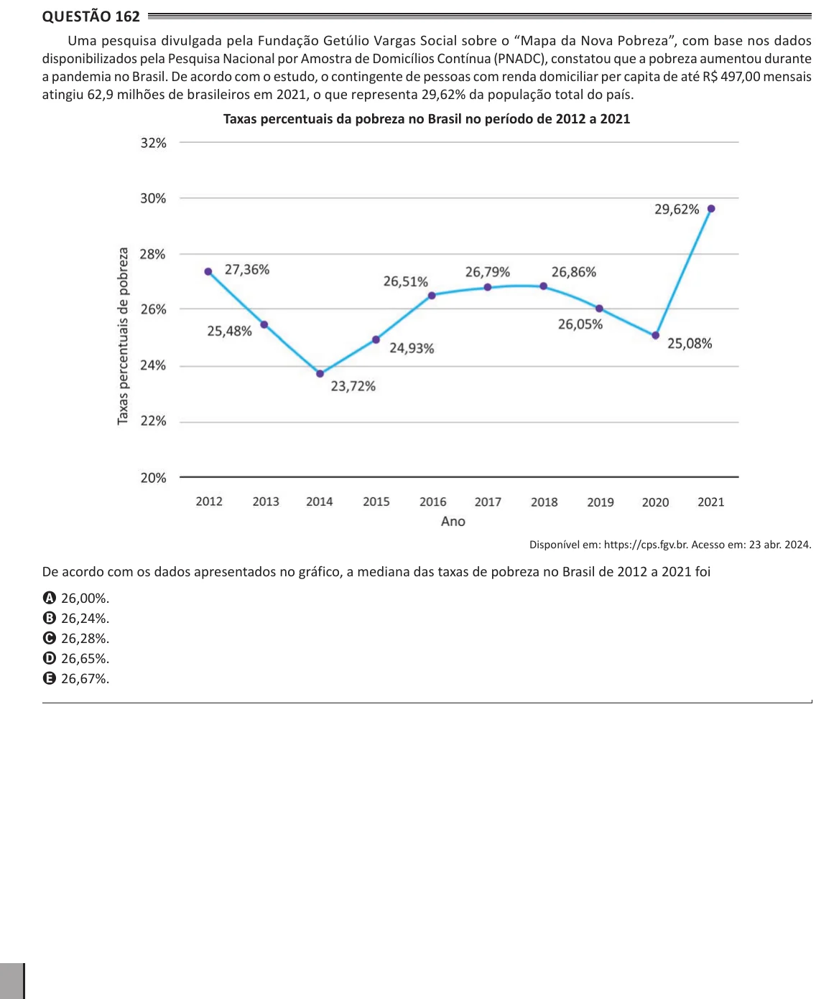

Texto extraído (pode conter ruído)

Questão 162  
Uma pesquisa divulgada pela Fundação Getúlio Vargas Social sobre o “Mapa da Nova Pobreza”, com base nos dados  
disponibilizados pela Pesquisa Nacional por Amostra de Domicílios Contínua (PNADC), constatou que a pobreza aumentou durante  
a pandemia no Brasil. De acordo com o estudo, o contingente de pessoas com renda domiciliar per capita de até R$ 497,00 mensais  
atingiu 62,9 milhões de brasileiros em 2021, o que representa 29,62% da população total do país.  
Taxas percentuais da pobreza no Brasil no período de 2012 a 2021  
Disponível em: https://cps.fgv.br. Acesso em: 23 abr. 2024.  
De acordo com os dados apresentados no gráfico, a mediana das taxas de pobreza no Brasil de 2012 a 2021 foi  
A 26,00%.  
B 26,24%.  
C 26,28%.  
D 26,65%.  
E 26,67%.

