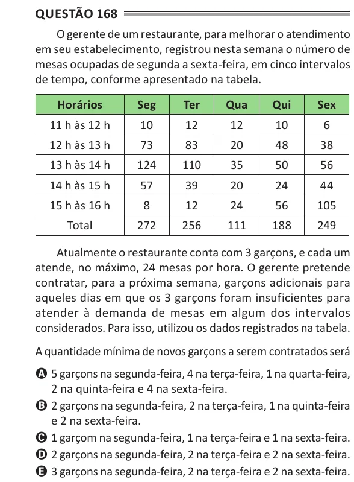

Texto extraído (pode conter ruído)

Questão 168  
O gerente de um restaurante, para melhorar o atendimento  
em seu estabelecimento, registrou nesta semana o número de  
mesas ocupadas de segunda a sexta-feira, em cinco intervalos  
de tempo, conforme apresentado na tabela.  
Horários  
seg  
ter  
Qua  
Qui  
sex  
11 h às 12 h  
10  
12  
12  
10  
6  
12 h às 13 h  
73  
83  
20  
48  
38  
13 h às 14 h  
124  
110  
35  
50  
56  
14 h às 15 h  
57  
39  
20  
24  
44  
15 h às 16 h  
8  
12  
24  
56  
105  
Total  
272  
256  
111  
188  
249  
Atualmente o restaurante conta com 3 garçons, e cada um  
atende, no máximo, 24 mesas por hora. O gerente pretende  
contratar, para a próxima semana, garçons adicionais para  
aqueles dias em que os 3 garçons foram insuficientes para  
atender à demanda de mesas em algum dos intervalos  
considerados. Para isso, utilizou os dados registrados na tabela.  
A quantidade mínima de novos garçons a serem contratados será  
A 5 garçons na segunda-feira, 4 na terça-feira, 1 na quarta-feira,  
2 na quinta-feira e 4 na sexta-feira.  
B 2 garçons na segunda-feira, 2 na terça-feira, 1 na quinta-feira  
e 2 na sexta-feira.  
C 1 garçom na segunda-feira, 1 na terça-feira e 1 na sexta-feira.  
D 2 garçons na segunda-feira, 2 na terça-feira e 2 na sexta-feira.  
E 3 garçons na segunda-feira, 2 na terça-feira e 2 na sexta-feira.

