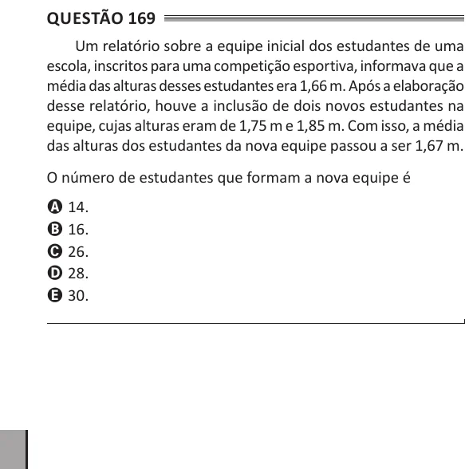

Texto extraído (pode conter ruído)

Questão 169  
Um relatório sobre a equipe inicial dos estudantes de uma  
escola, inscritos para uma competição esportiva, informava que a  
média das alturas desses estudantes era 1,66 m. Após a elaboração  
desse relatório, houve a inclusão de dois novos estudantes na  
equipe, cujas alturas eram de 1,75 m e 1,85 m. Com isso, a média  
das alturas dos estudantes da nova equipe passou a ser 1,67 m.  
O número de estudantes que formam a nova equipe é  
A 14.  
B 16.  
C 26.  
D 28.  
E 30.

