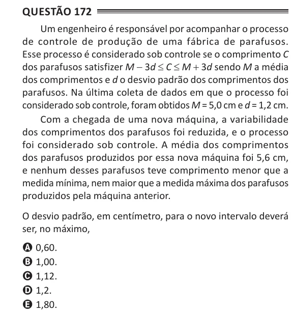

Texto extraído (pode conter ruído)

Questão 172  
Um engenheiro é responsável por acompanhar o processo  
de controle de produção de uma fábrica de parafusos.  
Esse processo é considerado sob controle se o comprimento C  
dos parafusos satisfizer M - 3d ≤ C ≤ M + 3d sendo M a média  
dos comprimentos e d o desvio padrão dos comprimentos dos  
parafusos. Na última coleta de dados em que o processo foi  
considerado sob controle, foram obtidos M = 5,0 cm e d = 1,2 cm.  
Com a chegada de uma nova máquina, a variabilidade  
dos comprimentos dos parafusos foi reduzida, e o processo  
foi considerado sob controle. A média dos comprimentos  
dos parafusos produzidos por essa nova máquina foi 5,6 cm,  
e nenhum desses parafusos teve comprimento menor que a  
medida mínima, nem maior que a medida máxima dos parafusos  
produzidos pela máquina anterior.  
O desvio padrão, em centímetro, para o novo intervalo deverá  
ser, no máximo,  
A 0,60.  
B 1,00.  
C 1,12.  
D 1,2.  
E 1,80.

