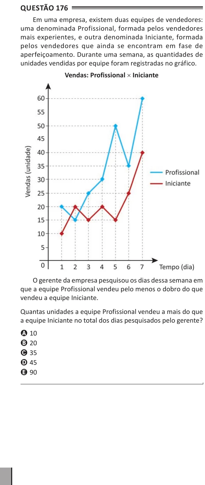

Texto extraído (pode conter ruído)

Questão 176  
Em uma empresa, existem duas equipes de vendedores:  
uma denominada Profissional, formada pelos vendedores  
mais experientes, e outra denominada Iniciante, formada  
pelos vendedores que ainda se encontram em fase de  
aperfeiçoamento. Durante uma semana, as quantidades de  
unidades vendidas por equipe foram registradas no gráfico.  
Vendas: Profissional × Iniciante  
O gerente da empresa pesquisou os dias dessa semana em  
que a equipe Profissional vendeu pelo menos o dobro do que  
vendeu a equipe Iniciante.  
Quantas unidades a equipe Profissional vendeu a mais do que  
a equipe Iniciante no total dos dias pesquisados pelo gerente?  
A 10  
B 20  
C 35  
D 45  
E 90

