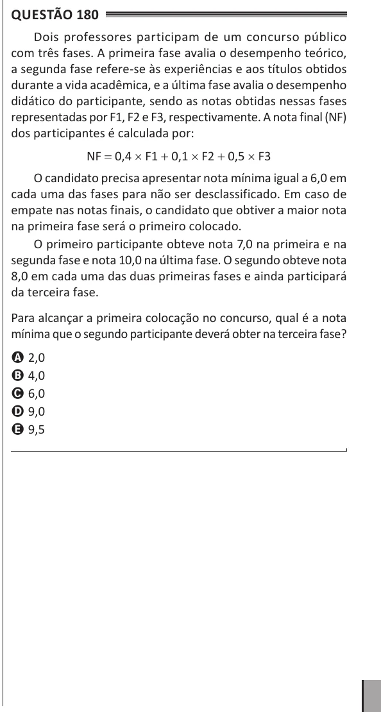

Texto extraído (pode conter ruído)

Questão 180  
Dois professores participam de um concurso público  
com três fases. A primeira fase avalia o desempenho teórico,  
a segunda fase refere-se às experiências e aos títulos obtidos  
durante a vida acadêmica, e a última fase avalia o desempenho  
didático do participante, sendo as notas obtidas nessas fases  
representadas por F1, F2 e F3, respectivamente. A nota final (NF)  
dos participantes é calculada por:  
NF = 0,4 × F1 + 0,1 × F2 + 0,5 × F3  
O candidato precisa apresentar nota mínima igual a 6,0 em  
cada uma das fases para não ser desclassificado. Em caso de  
empate nas notas finais, o candidato que obtiver a maior nota  
na primeira fase será o primeiro colocado.  
O primeiro participante obteve nota 7,0 na primeira e na  
segunda fase e nota 10,0 na última fase. O segundo obteve nota  
8,0 em cada uma das duas primeiras fases e ainda participará  
da terceira fase.  
Para alcançar a primeira colocação no concurso, qual é a nota  
mínima que o segundo participante deverá obter na terceira fase?  
A 2,0  
B 4,0  
C 6,0  
D 9,0  
E 9,5

