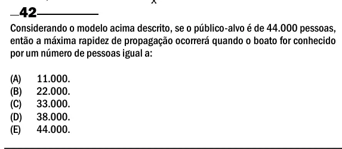

Texto extraído (pode conter ruído)

42  
Considerando o modelo acima descrito, se o público-alvo é de 44.000 pessoas,  
então a máxima rapidez de propagação ocorrerá quando o boato for conhecido  
por um número de pessoas igual a:  
(A)  
11.000.  
(B)  
22.000.  
(C)  
33.000.  
(D)  
38.000.  
(E)  
44.000.

