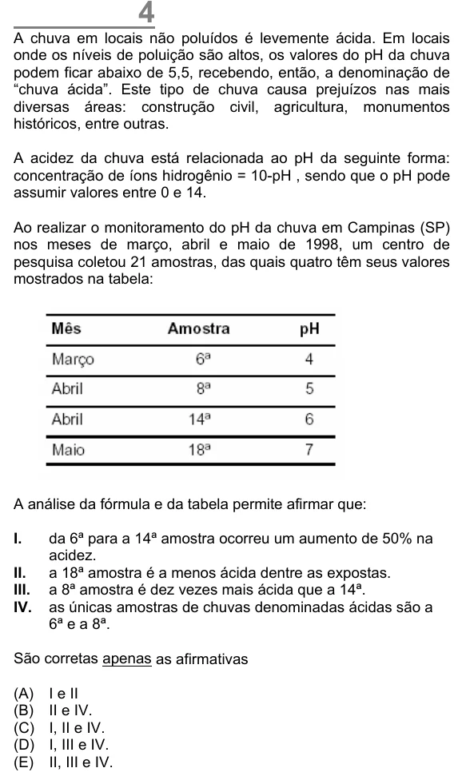

Texto extraído (pode conter ruído)

A chuva em locais não poluídos é levemente ácida. Em locais  
onde os níveis de poluição são altos, os valores do pH da chuva  
podem ficar abaixo de 5,5, recebendo, então, a denominação de  
“chuva ácida”. Este tipo de chuva causa prejuízos nas mais  
diversas áreas: construção civil, agricultura, monumentos  
históricos, entre outras.  
A acidez da chuva está relacionada ao pH da seguinte forma:  
concentração de íons hidrogênio = 10-pH , sendo que o pH pode  
assumir valores entre 0 e 14.  
Ao realizar o monitoramento do pH da chuva em Campinas (SP)  
nos meses de março, abril e maio de 1998, um centro de  
pesquisa coletou 21 amostras, das quais quatro têm seus valores  
mostrados na tabela:  
A análise da fórmula e da tabela permite afirmar que:  
I.  
da 6ª para a 14ª amostra ocorreu um aumento de 50% na  
acidez.  
II.  
a 18ª amostra é a menos ácida dentre as expostas.  
III.  
a 8ª amostra é dez vezes mais ácida que a 14ª.  
IV.  
as únicas amostras de chuvas denominadas ácidas são a  
6ª e a 8ª.  
São corretas apenas as afirmativas  
(A)  
I e II  
(B)  
II e IV.  
(C)  
I, II e IV.  
(D)  
I, III e IV.  
(E)  
II, III e IV.

