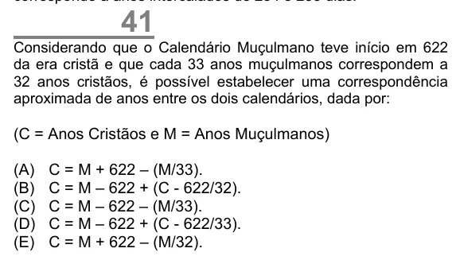

Texto extraído (pode conter ruído)

41  
Considerando que o Calendário Muçulmano teve início em 622  
da era cristã e que cada 33 anos muçulmanos correspondem a  
32 anos cristãos, é possível estabelecer uma correspondência  
aproximada de anos entre os dois calendários, dada por:  
(C = Anos Cristãos e M = Anos Muçulmanos)  
(A)  
C = M + 622 – (M/33).  
(B)  
C = M – 622 + (C - 622/32).  
(C)  
C = M – 622 – (M/33).  
(D)  
C = M – 622 + (C - 622/33).  
(E)  
C = M + 622 – (M/32).

