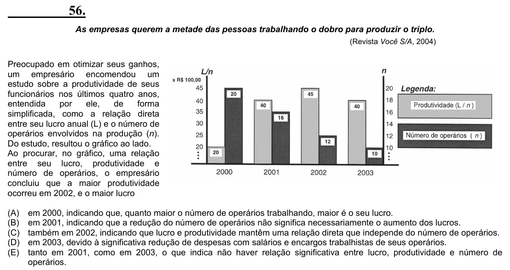

Texto extraído (pode conter ruído)

56.  
As empresas querem a metade das pessoas trabalhando o dobro para produzir o triplo.  
(Revista Você S/A, 2004)  
Preocupado em otimizar seus ganhos,  
um empresário encomendou um  
estudo sobre a produtividade de seus  
funcionários nos últimos quatro anos,  
entendida  
por  
ele,  
de  
forma  
simplificada, como a relação direta  
entre seu lucro anual (L) e o número de  
operários envolvidos na produção (n).  
Do estudo, resultou o gráfico ao lado.  
Ao procurar, no gráfico, uma relação  
entre seu lucro, produtividade e  
número de operários, o empresário  
concluiu que a maior produtividade  
ocorreu em 2002, e o maior lucro  
(A)  
em 2000, indicando que, quanto maior o número de operários trabalhando, maior é o seu lucro.  
(B)  
em 2001, indicando que a redução do número de operários não significa necessariamente o aumento dos lucros.  
(C)  
também em 2002, indicando que lucro e produtividade mantêm uma relação direta que independe do número de operários.  
(D)  
em 2003, devido à significativa redução de despesas com salários e encargos trabalhistas de seus operários.  
(E)  
tanto em 2001, como em 2003, o que indica não haver relação significativa entre lucro, produtividade e número de  
operários.

