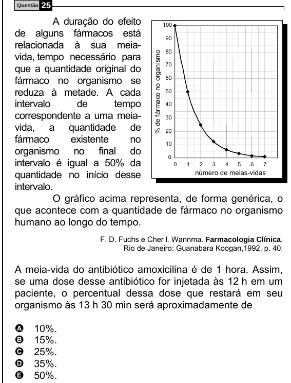

Texto extraído (pode conter ruído)

Questão  
25  
A duração do efeito  
100  
de alguns fármacos está  
90  
relacionada à sua meia-  
% de fármaco no organismo  
80  
vida, tempo necessário para  
que a quantidade original do  
70  
fármaco no organismo se  
60  
reduza à metade. A cada  
50  
intervalo  
de  
tempo  
40  
correspondente a uma meia-  
30  
vida, a quantidade de  
20  
fármaco  
existente  
no  
10  
organismo no final do  
0  
intervalo é igual a 50% da  
0  
1  
2  
3  
4  
5  
6  
7  
quantidade no início desse  
número de meias-vidas  
intervalo.  
O gráfico acima representa, de forma genérica, o  
que acontece com a quantidade de fármaco no organismo  
humano ao longo do tempo.  
F. D. Fuchs e Cher l. Wannma. Farmacologia Clínica.  
Rio de Janeiro: Guanabara Koogan,1992, p. 40.  
A meia-vida do antibiótico amoxicilina é de 1 hora. Assim,  
se uma dose desse antibiótico for injetada às 12 h em um  
paciente, o percentual dessa dose que restará em seu  
organismo às 13 h 30 min será aproximadamente de  
10%.  
A  
B  
15%.  
25%.  
C  
35%.  
D  
E  
50%.

