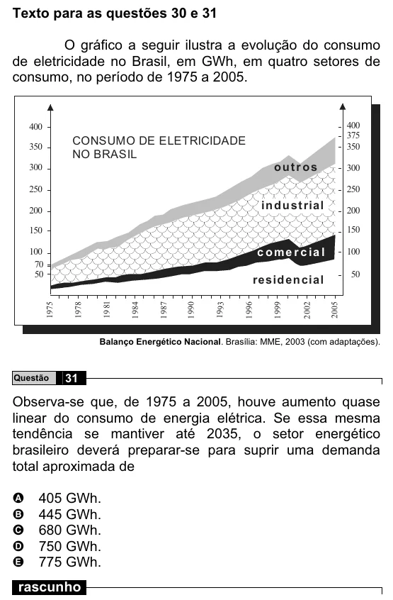

Texto extraído (pode conter ruído)

Texto para as questões 30 e 31  
O gráfico a seguir ilustra a evolução do consumo  
de eletricidade no Brasil, em GWh, em quatro setores de  
consumo, no período de 1975 a 2005.  
400  
400  
375  
CONSUMO DE ELETRICIDADE  
350  
350  
NO BRASIL  
outr os  
300  
300  
250  
250  
in d u st rial  
200  
200  
150  
150  
c o m e r c ia l  
100  
100  
70  
50  
resid en cial  
50  
1975  
1978  
19 81  
1 984  
1 987  
1 990  
1993  
1 996  
1 999  
2 002  
2005  
Balanço Energético Nacional. Brasília: MME, 2003 (com adaptações).  
31  
Questão  
Observa-se que, de 1975 a 2005, houve aumento quase  
linear do consumo de energia elétrica. Se essa mesma  
tendência se mantiver até 2035, o setor energético  
brasileiro deverá preparar-se para suprir uma demanda  
total aproximada de  
405 GWh.  
A  
B  
445 GWh.  
680 GWh.  
C  
750 GWh.  
D  
E  
775 GWh.  
rascunho

