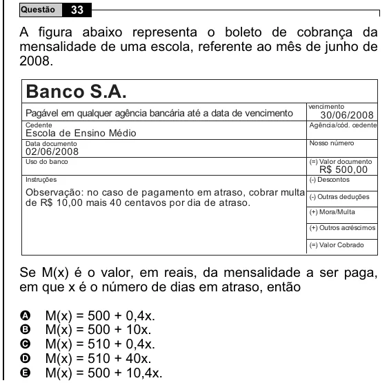

Texto extraído (pode conter ruído)

Questão  
33  
A figura abaixo representa o boleto de cobrança da  
mensalidade de uma escola, referente ao mês de junho de  
2008.  
Banco S.A.  
vencimento  
Pagável em qualquer agência bancária até a data de vencimento  
30/06/2008  
Cedente  
Agência/cód. cedente  
Escola de Ensino Médio  
Data documento  
Nosso número  
02/06/2008  
Uso do banco  
(=) Valor documento  
R$ 500,00  
Instruções  
(-) Descontos  
Observação: no caso de pagamento em atraso, cobrar multa (-) Outras deduções  
de R$ 10,00 mais 40 centavos por dia de atraso.  
(+) Mora/Multa  
(+) Outros acréscimos  
(=) Valor Cobrado  
Se M(x) é o valor, em reais, da mensalidade a ser paga,  
em que x é o número de dias em atraso, então  
M(x) = 500 + 0,4x.  
A  
B  
M(x) = 500 + 10x.  
C  
M(x) = 510 + 0,4x.  
M(x) = 510 + 40x.  
D  
E  
M(x) = 500 + 10,4x.

