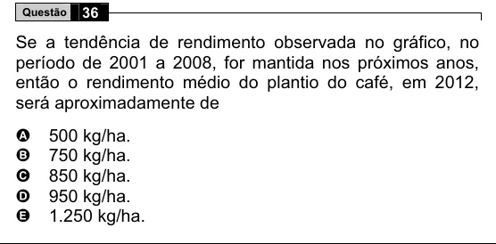

Texto extraído (pode conter ruído)

Questão  
36  
Se a tendência de rendimento observada no gráfico, no  
período de 2001 a 2008, for mantida nos próximos anos,  
então o rendimento médio do plantio do café, em 2012,  
será aproximadamente de  
500 kg/ha.  
A  
B  
750 kg/ha.  
850 kg/ha.  
C  
D  
950 kg/ha.  
E  
1.250 kg/ha.

