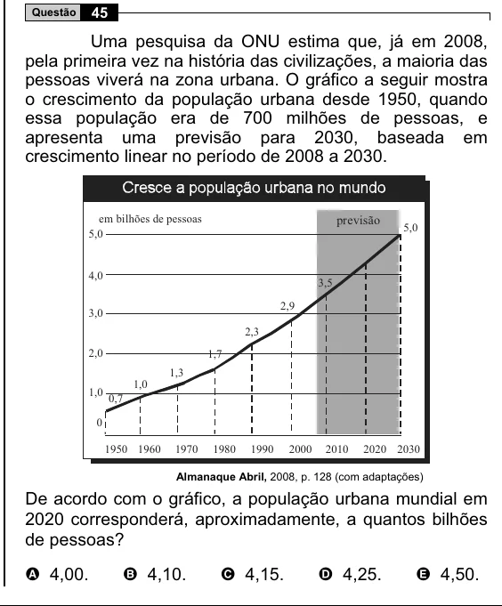

Texto extraído (pode conter ruído)

Questão  
45  
Uma pesquisa da ONU estima que, já em 2008,  
pela primeira vez na história das civilizações, a maioria das  
pessoas viverá na zona urbana. O gráfico a seguir mostra  
o crescimento da população urbana desde 1950, quando  
essa população era de 700 milhões de pessoas, e  
apresenta uma previsão para 2030, baseada em  
crescimento linear no período de 2008 a 2030.  
em bilhões de pessoas  
previsão  
5,0  
5,0  
4,0  
3,5  
2,9  
3,0  
2,3  
2,0  
1,7  
1,3  
1,0  
1,0 0,7  
0  
1950 1960  
1970  
1980  
1990  
2000  
2010  
2020 2030  
Almanaque Abril, 2008, p. 128 (com adaptações)  
De acordo com o gráfico, a população urbana mundial em  
2020 corresponderá, aproximadamente, a quantos bilhões  
de pessoas?  
A 4,00.  
B 4,10.  
C 4,15.  
D 4,25.  
E 4,50.

