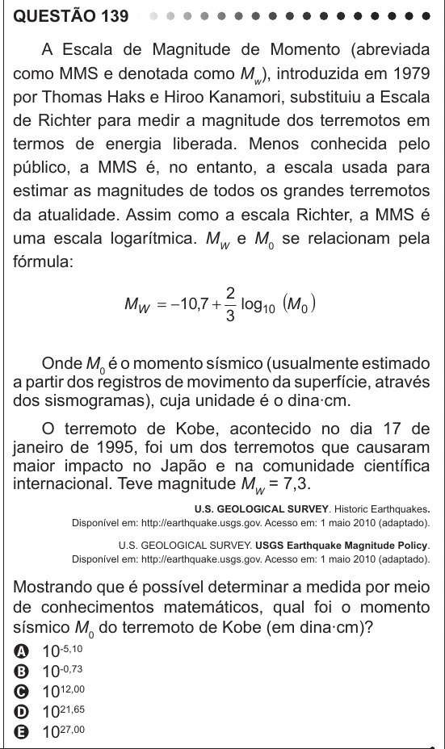

Texto extraído (pode conter ruído)

QUESTÃO 139  
A Escala de Magnitude de Momento (abreviada  
como MMS e denotada como M w ), introduzida em 1979  
por Thomas Haks e Hiroo Kanamori, substituiu a Escala  
de Richter para medir a magnitude dos terremotos em  
termos de energia liberada. Menos conhecida pelo  
público, a MMS é, no entanto, a escala usada para  
estimar as magnitudes de todos os grandes terremotos  
da atualidade. Assim como a escala Richter, a MMS é  
uma escala logarítmica. M W e M 0 se relacionam pela  
fórmula:  
2  
log 10 ( M 0 )  
M W = − 10 , 7 +  
3  
Onde M 0 é o momento sísmico (usualmente estimado  
a partir dos registros de movimento da superfície, através  
dos sismogramas), cuja unidade é o dina∙cm.  
O terremoto de Kobe, acontecido no dia 17 de  
janeiro de 1995, foi um dos terremotos que causaram  
maior impacto no Japão e na comunidade científica  
internacional. Teve magnitude M W = 7,3.  
U.S. GEOLOGICAL SURVEY. Historic Earthquakes.  
Disponível em: http://earthquake.usgs.gov. Acesso em: 1 maio 2010 (adaptado).  
U.S. GEOLOGICAL SURVEY. USGS Earthquake Magnitude Policy.  
Disponível em: http://earthquake.usgs.gov. Acesso em: 1 maio 2010 (adaptado).  
Mostrando que é possível determinar a medida por meio  
de conhecimentos matemáticos, qual foi o momento  
sísmico M 0 do terremoto de Kobe (em dina∙cm)?  
A 10 -5,10  
B 10 -0,73  
C 10 12,00  
D 10 21,65  
E 10 27,00

