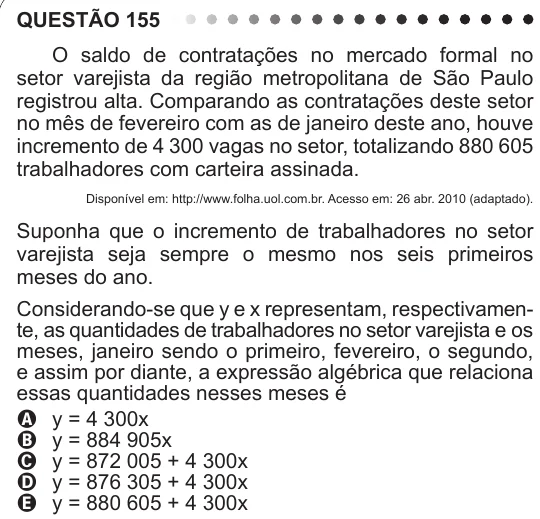

Texto extraído (pode conter ruído)

QUESTÃO 155  
O saldo de contratações no mercado formal no  
setor varejista da região metropolitana de São Paulo  
registrou alta. Comparando as contratações deste setor  
no mês de fevereiro com as de janeiro deste ano, houve  
incremento de 4 300 vagas no setor, totalizando 880 605  
trabalhadores com carteira assinada.  
Disponível em: http://www.folha.uol.com.br. Acesso em: 26 abr. 2010 (adaptado).  
Suponha que o incremento de trabalhadores no setor  
varejista seja sempre o mesmo nos seis primeiros  
meses do ano.  
Considerando-se que y e x representam, respectivamen-  
te, as quantidades de trabalhadores no setor varejista e os  
meses, janeiro sendo o primeiro, fevereiro, o segundo,  
e assim por diante, a expressão algébrica que relaciona  
essas quantidades nesses meses é  
A y = 4 300x  
B y = 884 905x  
C y = 872 005 + 4 300x  
D y = 876 305 + 4 300x  
E y = 880 605 + 4 300x

