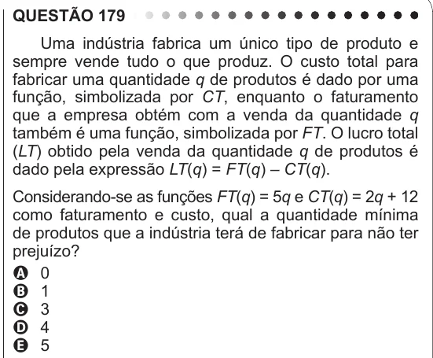

Texto extraído (pode conter ruído)

QUESTÃO 179  
Uma indústria fabrica um único tipo de produto e  
sempre vende tudo o que produz. O custo total para  
fabricar uma quantidade q de produtos é dado por uma  
função, simbolizada por CT, enquanto o faturamento  
que a empresa obtém com a venda da quantidade q  
também é uma função, simbolizada por FT. O lucro total  
(LT) obtido pela venda da quantidade q de produtos é  
dado pela expressão LT(q) = FT(q) – CT(q).  
Considerando-se as funções FT(q) = 5q e CT(q) = 2q + 12  
como faturamento e custo, qual a quantidade mínima  
de produtos que a indústria terá de fabricar para não ter  
prejuízo?  
A 0  
B 1  
C 3  
D 4  
E 5

