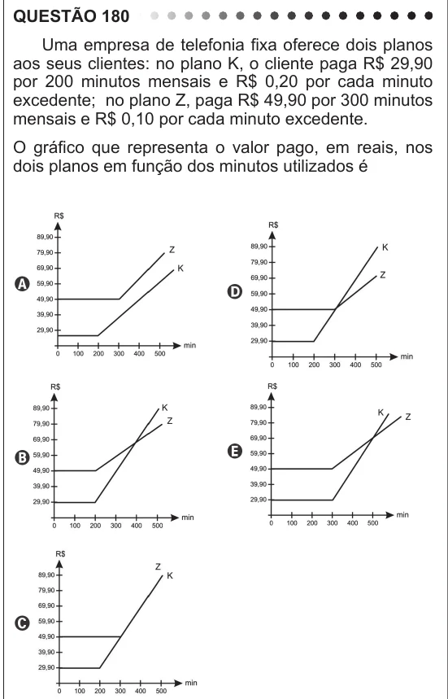

Texto extraído (pode conter ruído)

QUESTÃO 180  
Uma empresa de telefonia fixa oferece dois planos  
aos seus clientes: no plano K, o cliente paga R$ 29,90  
por 200 minutos mensais e R$ 0,20 por cada minuto  
excedente; no plano Z, paga R$ 49,90 por 300 minutos  
mensais e R$ 0,10 por cada minuto excedente.  
O gráfico que representa o valor pago, em reais, nos  
dois planos em função dos minutos utilizados é

