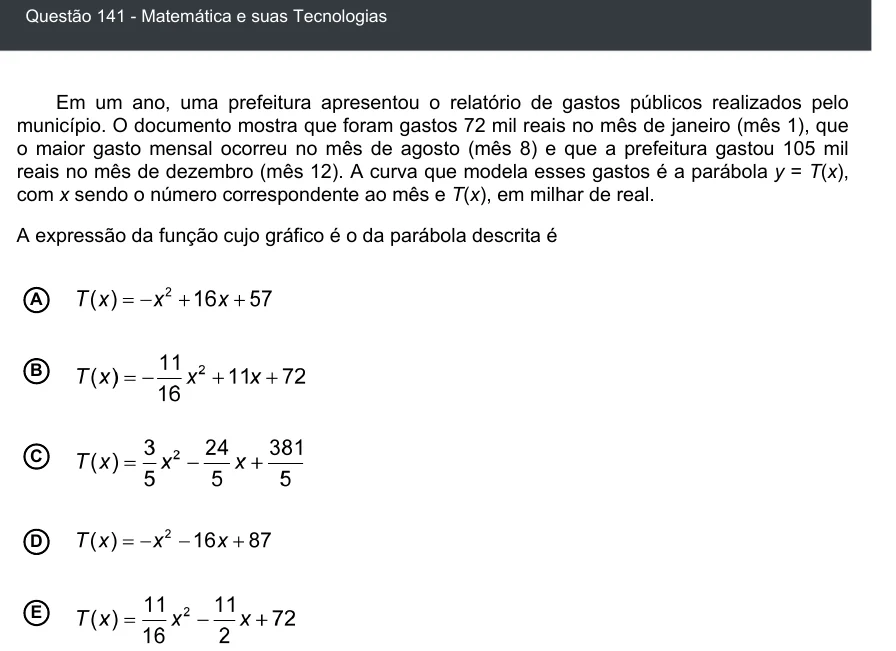

Texto extraído (pode conter ruído)

Questão 141 - Matemática e suas Tecnologias  
Em um ano, uma prefeitura apresentou o relatório de gastos públicos realizados pelo  
município. O documento mostra que foram gastos 72 mil reais no mês de janeiro (mês 1), que  
o maior gasto mensal ocorreu no mês de agosto (mês 8) e que a prefeitura gastou 105 mil  
reais no mês de dezembro (mês 12). A curva que modela esses gastos é a parábola y = T(x),  
com x sendo o número correspondente ao mês e T(x), em milhar de real.  
A expressão da função cujo gráfico é o da parábola descrita é  
A  
B  
C  
D  
E

