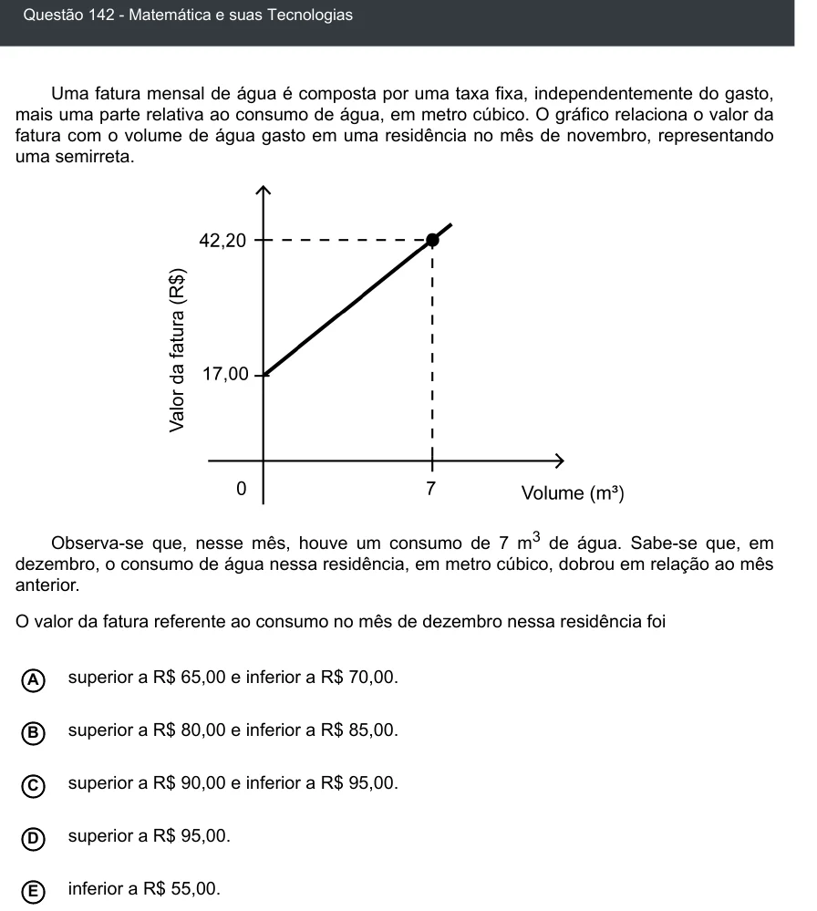

Texto extraído (pode conter ruído)

Questão 142 - Matemática e suas Tecnologias  
Uma fatura mensal de água é composta por uma taxa fixa, independentemente do gasto,  
mais uma parte relativa ao consumo de água, em metro cúbico. O gráfico relaciona o valor da  
fatura com o volume de água gasto em uma residência no mês de novembro, representando  
uma semirreta.  
Observa-se que, nesse mês, houve um consumo de 7 m 3 de água. Sabe-se que, em  
dezembro, o consumo de água nessa residência, em metro cúbico, dobrou em relação ao mês  
anterior.  
O valor da fatura referente ao consumo no mês de dezembro nessa residência foi  
superior a R$ 65,00 e inferior a R$ 70,00.  
A  
B  
superior a R$ 80,00 e inferior a R$ 85,00.  
C  
superior a R$ 90,00 e inferior a R$ 95,00.  
superior a R$ 95,00.  
D  
inferior a R$ 55,00.  
E

