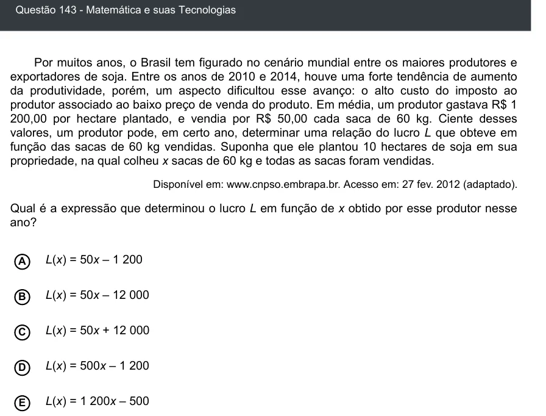

Texto extraído (pode conter ruído)

Questão 143 - Matemática e suas Tecnologias  
Por muitos anos, o Brasil tem figurado no cenário mundial entre os maiores produtores e  
exportadores de soja. Entre os anos de 2010 e 2014, houve uma forte tendência de aumento  
da produtividade, porém, um aspecto dificultou esse avanço: o alto custo do imposto ao  
produtor associado ao baixo preço de venda do produto. Em média, um produtor gastava R$ 1  
200,00 por hectare plantado, e vendia por R$ 50,00 cada saca de 60 kg. Ciente desses  
valores, um produtor pode, em certo ano, determinar uma relação do lucro L que obteve em  
função das sacas de 60 kg vendidas. Suponha que ele plantou 10 hectares de soja em sua  
propriedade, na qual colheu x sacas de 60 kg e todas as sacas foram vendidas.  
Disponível em: www.cnpso.embrapa.br. Acesso em: 27 fev. 2012 (adaptado).  
Qual é a expressão que determinou o lucro L em função de x obtido por esse produtor nesse  
ano?  
L(x) = 50x – 1 200  
A  
B  
L(x) = 50x – 12 000  
L(x) = 50x + 12 000  
C  
L(x) = 500x – 1 200  
D  
E  
L(x) = 1 200x – 500

