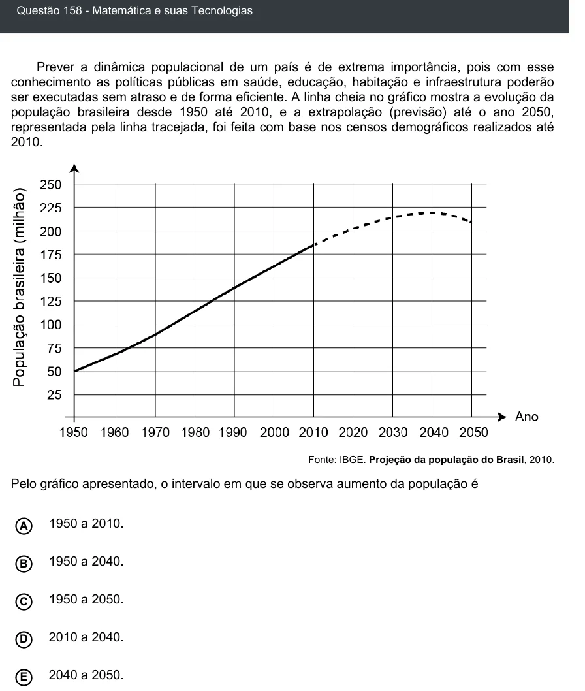

Texto extraído (pode conter ruído)

Questão 158 - Matemática e suas Tecnologias  
Prever a dinâmica populacional de um país é de extrema importância, pois com esse  
conhecimento as políticas públicas em saúde, educação, habitação e infraestrutura poderão  
ser executadas sem atraso e de forma eficiente. A linha cheia no gráfico mostra a evolução da  
população brasileira desde 1950 até 2010, e a extrapolação (previsão) até o ano 2050,  
representada pela linha tracejada, foi feita com base nos censos demográficos realizados até  
2010.  
Fonte: IBGE. Projeção da população do Brasil, 2010.  
Pelo gráfico apresentado, o intervalo em que se observa aumento da população é  
A  
1950 a 2010.  
1950 a 2040.  
B  
1950 a 2050.  
C  
D  
2010 a 2040.  
E  
2040 a 2050.

