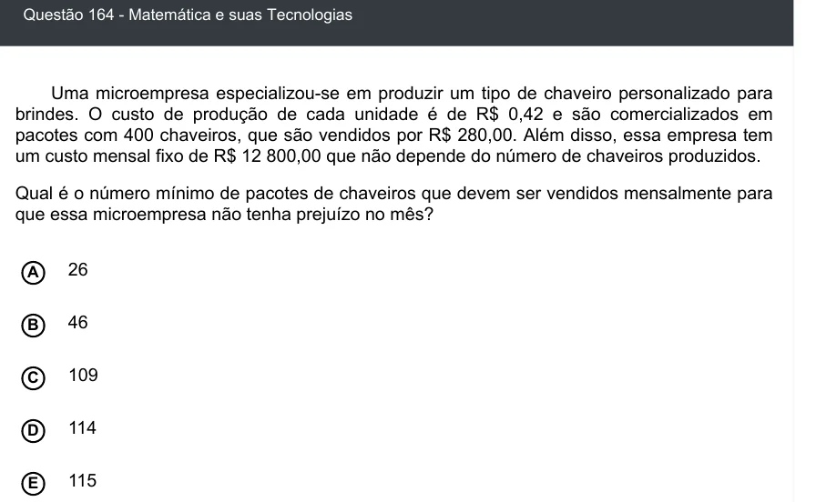

Texto extraído (pode conter ruído)

Questão 164 - Matemática e suas Tecnologias  
Uma microempresa especializou-se em produzir um tipo de chaveiro personalizado para  
brindes. O custo de produção de cada unidade é de R$ 0,42 e são comercializados em  
pacotes com 400 chaveiros, que são vendidos por R$ 280,00. Além disso, essa empresa tem  
um custo mensal fixo de R$ 12 800,00 que não depende do número de chaveiros produzidos.  
Qual é o número mínimo de pacotes de chaveiros que devem ser vendidos mensalmente para  
que essa microempresa não tenha prejuízo no mês?  
A  
26  
46  
B  
109  
C  
D  
114  
115  
E

