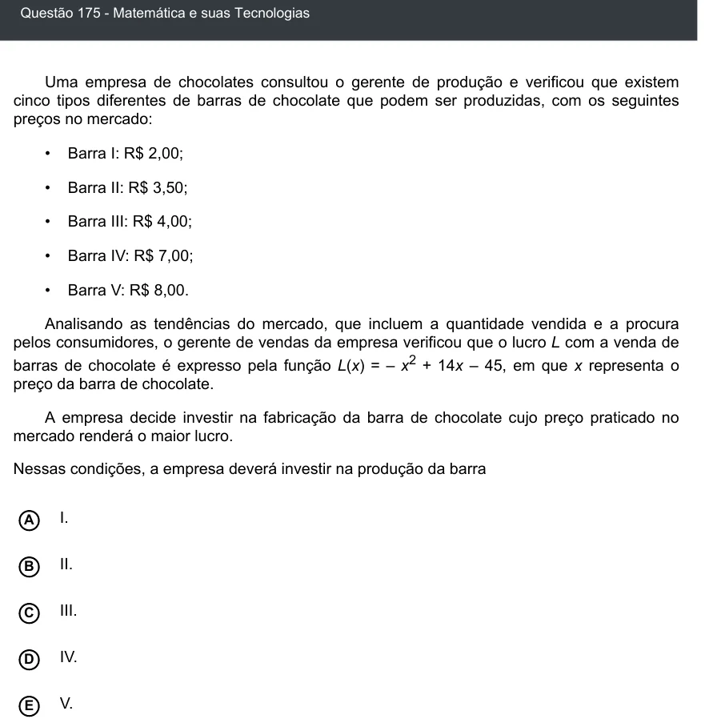

Texto extraído (pode conter ruído)

Questão 175 - Matemática e suas Tecnologias  
Uma empresa de chocolates consultou o gerente de produção e verificou que existem  
cinco tipos diferentes de barras de chocolate que podem ser produzidas, com os seguintes  
preços no mercado:  
•  
Barra I: R$ 2,00;  
•  
Barra II: R$ 3,50;  
•  
Barra III: R$ 4,00;  
•  
Barra IV: R$ 7,00;  
•  
Barra V: R$ 8,00.  
Analisando as tendências do mercado, que incluem a quantidade vendida e a procura  
pelos consumidores, o gerente de vendas da empresa verificou que o lucro L com a venda de  
barras de chocolate é expresso pela função L(x) = – x 2 + 14x – 45, em que x representa o  
preço da barra de chocolate.  
A empresa decide investir na fabricação da barra de chocolate cujo preço praticado no  
mercado renderá o maior lucro.  
Nessas condições, a empresa deverá investir na produção da barra  
A  
I.  
II.  
B  
III.  
C  
D  
IV.  
V.  
E

