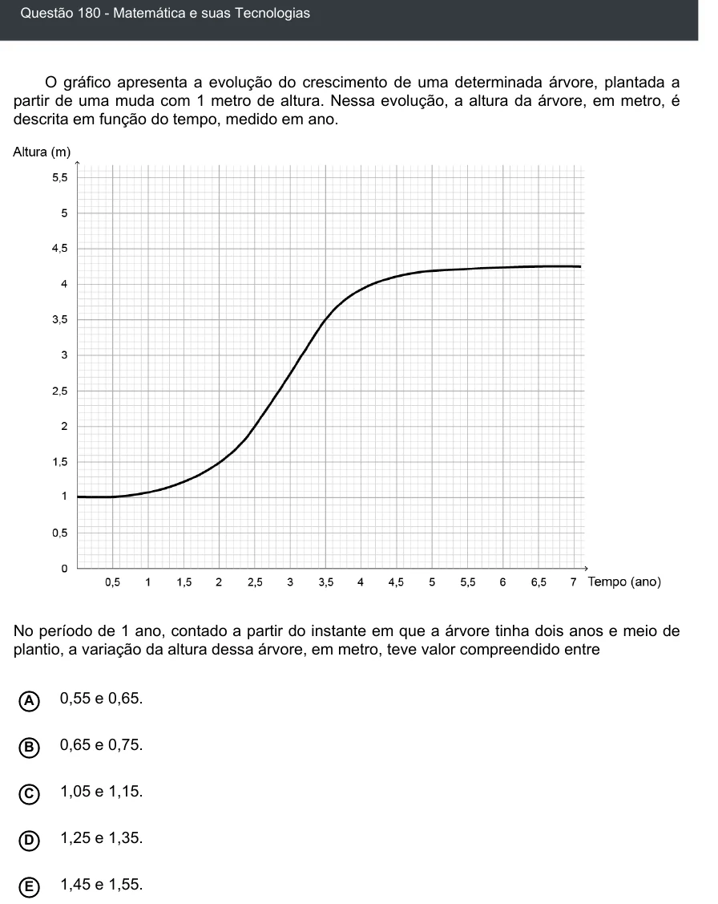

Texto extraído (pode conter ruído)

Questão 180 - Matemática e suas Tecnologias  
O gráfico apresenta a evolução do crescimento de uma determinada árvore, plantada a  
partir de uma muda com 1 metro de altura. Nessa evolução, a altura da árvore, em metro, é  
descrita em função do tempo, medido em ano.  
No período de 1 ano, contado a partir do instante em que a árvore tinha dois anos e meio de  
plantio, a variação da altura dessa árvore, em metro, teve valor compreendido entre  
A  
0,55 e 0,65.  
0,65 e 0,75.  
B  
1,05 e 1,15.  
C  
D  
1,25 e 1,35.  
E  
1,45 e 1,55.

