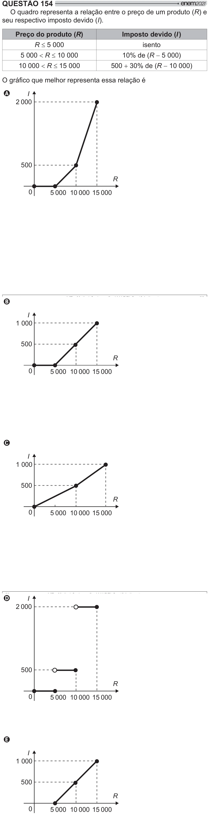

Texto extraído (pode conter ruído)

QUESTÃO 154  
O quadro representa a relação entre o preço de um produto (R) e  
seu respectivo imposto devido (I).  
Preço do produto (R)  
Imposto devido (I )  
R d 5 000  
isento  
5 000  R d 10 000  
10% de (R  5 000)  
10 000  R d 15 000  
500  30% de (R  10 000)  
/  
 $ #  
   
 =[<  
A  
I  
2 000  
500  
R  
0  
5 000 10 000 15 000  
B  
I  
1 000  
500  
R  
0  
5 000 10 000 15 000  
C  
I  
1 000  
500  
R  
0  
5 000 10 000 15 000  
D  
I  
2 000  
500  
R  
0  
5 000 10 000 15 000  
E  
I  
1 000  
500  
R  
0  
5 000 10 000 15 000

