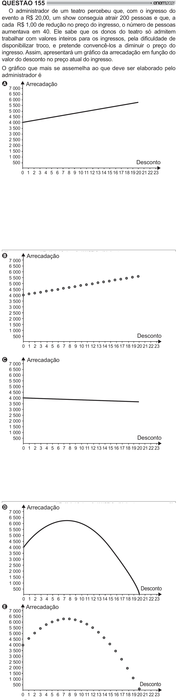

Texto extraído (pode conter ruído)

QUESTÃO 155  
O administrador de um teatro percebeu que, com o ingresso do  
evento a R$ 20,00, um show conseguia atrair 200 pessoas e que, a  
cada R$ 1,00 de redução no preço do ingresso, o número de pessoas  
aumentava em 40. Ele sabe que os donos do teatro só admitem  
y$  "     #      #        
disponibilizar troco, e pretende convencê-los a diminuir o preço do  
 ! #  
 / / =[ > =[  
valor do desconto no preço atual do ingresso.  
/  
    
 $  
 "   
 y#   
administrador é  
A  
Arrecadação  
7 000  
6 500  
6 000  
5 500  
5 000  
4 500  
4 000  
3 500  
3 000  
2 500  
2 000  
1 500  
1 000  
Desconto  
500  
0 1 2 3 4 5 6 7 8 9 10 11 12 13 14 15 16 17 18 19 20 21 22 23  
B  
Arrecadação  
7 000  
6 500  
6 000  
5 500  
5 000  
4 500  
4 000  
3 500  
3 000  
2 500  
2 000  
1 500  
1 000  
Desconto  
500  
0 1 2 3 4 5 6 7 8 9 10 11 12 13 14 15 16 17 18 19 20 21 22 23  
C  
Arrecadação  
7 000  
6 500  
6 000  
5 500  
5 000  
4 500  
4 000  
3 500  
3 000  
2 500  
2 000  
1 500  
1 000  
Desconto  
500  
0 1 2 3 4 5 6 7 8 9 10 11 12 13 14 15 16 17 18 19 20 21 22 23  
D  
Arrecadação  
7 000  
6 500  
6 000  
5 500  
5 000  
4 500  
4 000  
3 500  
3 000  
2 500  
2 000  
1 500  
1 000  
Desconto  
500  
0 1 2 3 4 5 6 7 8 9 10 11 12 13 14 15 16 17 18 19 20 21 22 23  
E  
Arrecadação  
7 000  
6 500  
6 000  
5 500  
5 000  
4 500  
4 000  
3 500  
3 000  
2 500  
2 000  
1 500  
1 000  
Desconto  
500  
0 1 2 3 4 5 6 7 8 9 10 11 12 13 14 15 16 17 18 19 20 21 22 23

