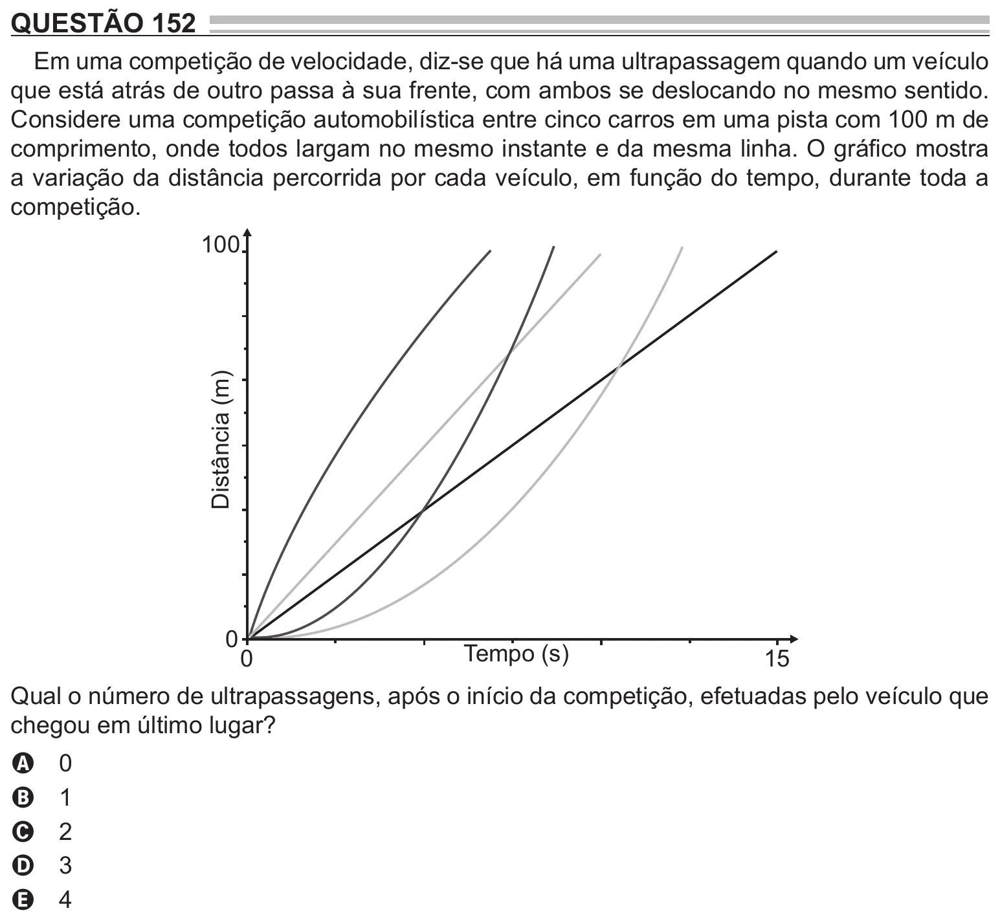

Texto extraído (pode conter ruído)

QUESTÃO 152  
Em uma competição de velocidade, diz-se que há uma ultrapassagem quando um veículo  
que está atrás de outro passa à sua frente, com ambos se deslocando no mesmo sentido.  
Considere uma competição automobilística entre cinco carros em uma pista com 100 m de  
comprimento, onde todos largam no mesmo instante e da mesma linha. O gráfico mostra  
a variação da distância percorrida por cada veículo, em função do tempo, durante toda a  
competição.  
100  
Distância (m)  
0  
Tempo (s)  
0  
15  
Qual o número de ultrapassagens, após o início da competição, efetuadas pelo veículo que  
chegou em último lugar?  
0  
A  
1  
B  
2  
C  
3  
D  
4  
E

