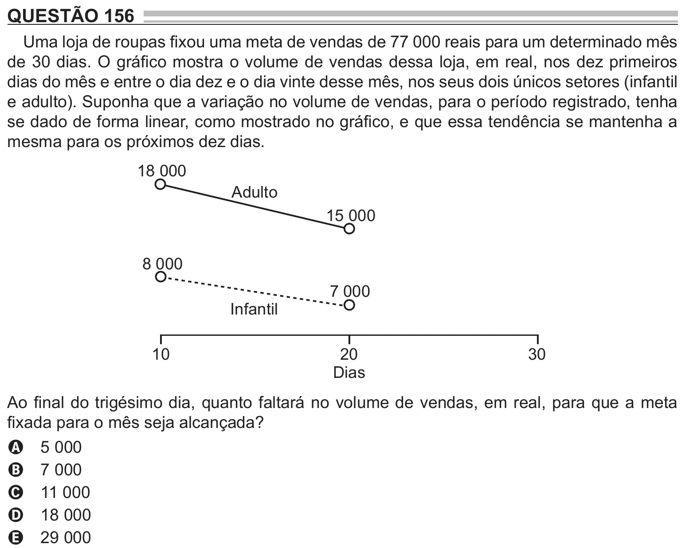

Texto extraído (pode conter ruído)

QUESTÃO 156  
Uma loja de roupas fixou uma meta de vendas de 77 000 reais para um determinado mês  
de 30 dias. O gráfico mostra o volume de vendas dessa loja, em real, nos dez primeiros  
dias do mês e entre o dia dez e o dia vinte desse mês, nos seus dois únicos setores (infantil  
e adulto). Suponha que a variação no volume de vendas, para o período registrado, tenha  
se dado de forma linear, como mostrado no gráfico, e que essa tendência se mantenha a  
mesma para os próximos dez dias.  
18 000  
Adulto  
15 000  
8 000  
7 000  
Infantil  
10  
20  
30  
Dias  
Ao final do trigésimo dia, quanto faltará no volume de vendas, em real, para que a meta  
fixada para o mês seja alcançada?  
5 000  
A  
7 000  
B  
11 000  
C  
18 000  
D  
29 000  
E

