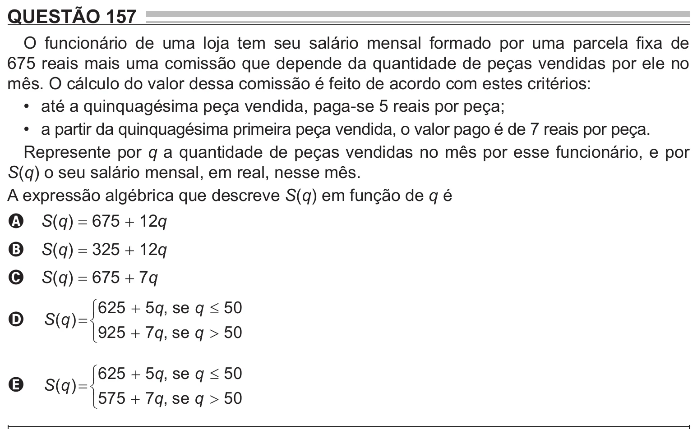

Texto extraído (pode conter ruído)

QUESTÃO 157  
O funcionário de uma loja tem seu salário mensal formado por uma parcela fixa de  
675 reais mais uma comissão que depende da quantidade de peças vendidas por ele no  
mês. O cálculo do valor dessa comissão é feito de acordo com estes critérios:  
• até a quinquagésima peça vendida, paga-se 5 reais por peça;  
• a partir da quinquagésima primeira peça vendida, o valor pago é de 7 reais por peça.  
Represente por q a quantidade de peças vendidas no mês por esse funcionário, e por  
S(q) o seu salário mensal, em real, nesse mês.  
A expressão algébrica que descreve S(q) em função de q é  
S(q) = 675 + 12q  
A  
S(q) = 325 + 12q  
B  
S(q) = 675 + 7q  
C  
 625  5 q , se q  50  
S ( q )    
D  
 925  7 q , se q  50  
 625  5 q , se q  50  
S ( q )    
E  
 575  7 q , se q  50

