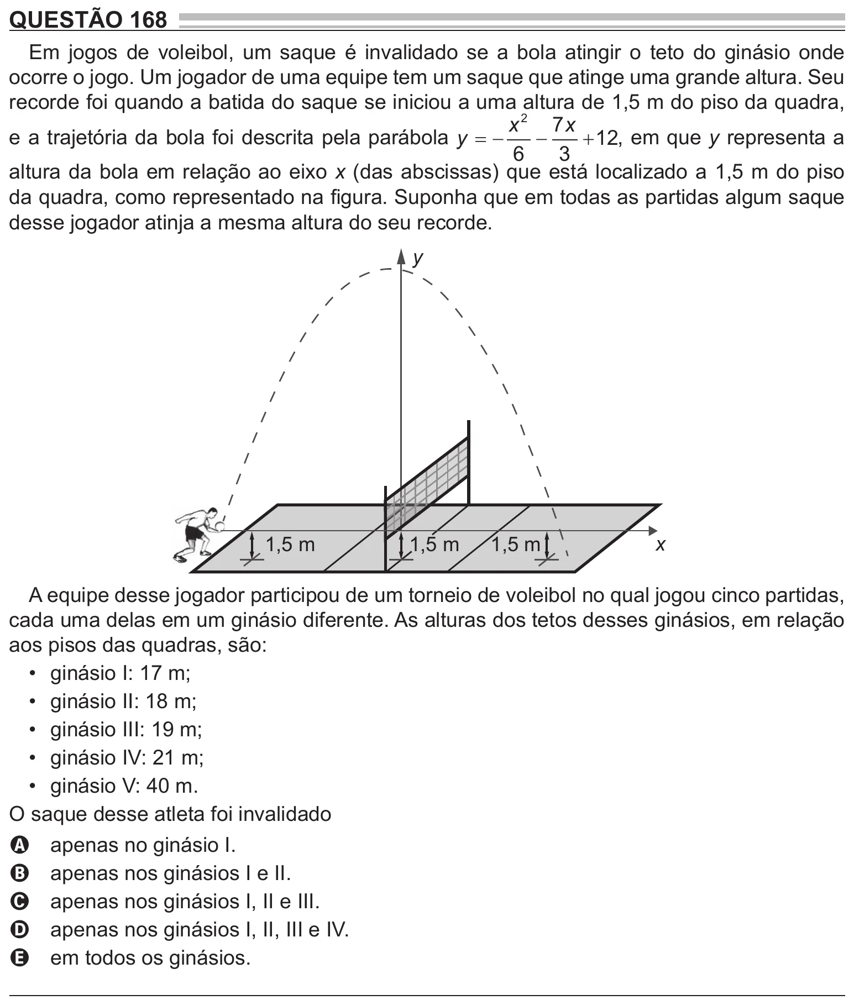

Texto extraído (pode conter ruído)

QUESTÃO 168  
Em jogos de voleibol, um saque é invalidado se a bola atingir o teto do ginásio onde  
ocorre o jogo. Um jogador de uma equipe tem um saque que atinge uma grande altura. Seu  
recorde foi quando a batida do saque se iniciou a uma altura de 1,5 m do piso da quadra,  
x 2 7 x  
e a trajetória da bola foi descrita pela parábola y    
  
 12, em que y representa a  
6  
3  
altura da bola em relação ao eixo x (das abscissas) que está localizado a 1,5 m do piso  
da quadra, como representado na figura. Suponha que em todas as partidas algum saque  
desse jogador atinja a mesma altura do seu recorde.  
y  
1,5 m  
1,5 m  
1,5 m  
x  
A equipe desse jogador participou de um torneio de voleibol no qual jogou cinco partidas,  
cada uma delas em um ginásio diferente. As alturas dos tetos desses ginásios, em relação  
aos pisos das quadras, são:  
• ginásio I: 17 m;  
• ginásio II: 18 m;  
• ginásio III: 19 m;  
• ginásio IV: 21 m;  
• ginásio V: 40 m.  
O saque desse atleta foi invalidado  
apenas no ginásio I.  
A  
apenas nos ginásios I e II.  
B  
apenas nos ginásios I, II e III.  
C  
apenas nos ginásios I, II, III e IV.  
D  
em todos os ginásios.  
E

