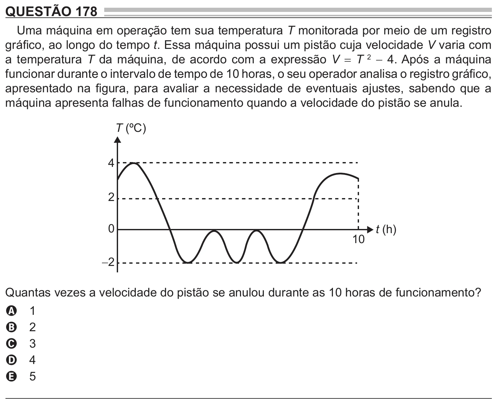

Texto extraído (pode conter ruído)

QUESTÃO 178  
Uma máquina em operação tem sua temperatura T monitorada por meio de um registro  
gráfico, ao longo do tempo t. Essa máquina possui um pistão cuja velocidade V varia com  
a temperatura T da máquina, de acordo com a expressão V = T 2 − 4. Após a máquina  
funcionar durante o intervalo de tempo de 10 horas, o seu operador analisa o registro gráfico,  
apresentado na figura, para avaliar a necessidade de eventuais ajustes, sabendo que a  
máquina apresenta falhas de funcionamento quando a velocidade do pistão se anula.  
T (ºC)  
4  
2  
0  
t (h)  
10  
−2  
Quantas vezes a velocidade do pistão se anulou durante as 10 horas de funcionamento?  
1  
A  
2  
B  
3  
C  
4  
D  
5  
E

