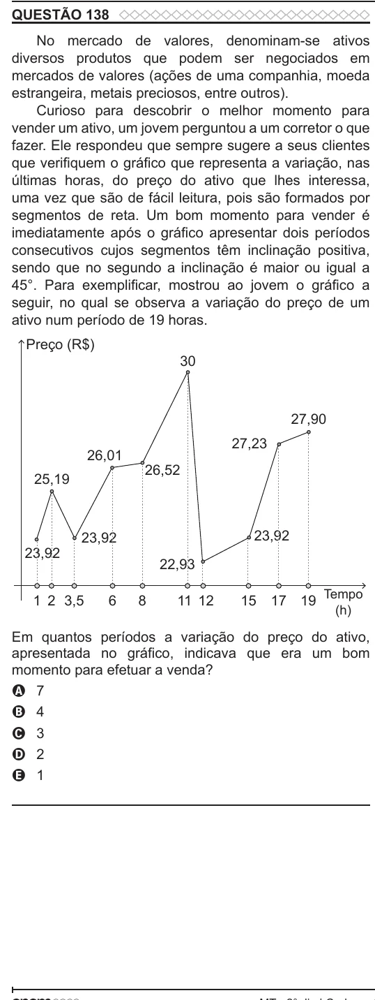

Texto extraído (pode conter ruído)

QUESTÃO 138  
No mercado de valores, denominam-se ativos  
diversos produtos que podem ser negociados em  
mercados de valores (ações de uma companhia, moeda  
estrangeira, metais preciosos, entre outros).  
Curioso para descobrir o melhor momento para  
vender um ativo, um jovem perguntou a um corretor o que  
fazer. Ele respondeu que sempre sugere a seus clientes  
que verifiquem o gráfico que representa a variação, nas  
últimas horas, do preço do ativo que lhes interessa,  
uma vez que são de fácil leitura, pois são formados por  
segmentos de reta. Um bom momento para vender é  
imediatamente após o gráfico apresentar dois períodos  
consecutivos cujos segmentos têm inclinação positiva,  
sendo que no segundo a inclinação é maior ou igual a  
45°. Para exemplificar, mostrou ao jovem o gráfico a  
seguir, no qual se observa a variação do preço de um  
ativo num período de 19 horas.  
Preço (R$)  
30  
27,90  
27,23  
26,01  
26,52  
25,19  
23,92  
23,92  
23,92  
22,93  
Tempo  
1 2 3,5  
6  
8  
11 12  
15  
17 19  
(h)  
Em quantos períodos a variação do preço do ativo,  
apresentada no gráfico, indicava que era um bom  
momento para efetuar a venda?  
A 7  
B 4  
C 3  
D 2  
E 1

