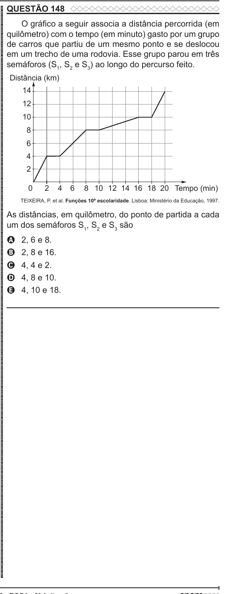

Texto extraído (pode conter ruído)

QUESTÃO 148  
ENEM 2022 ENEM 2022 ENEM 2022 ENEM 2022 ENEM 2022 ENEM 2022 ENEM 2022 ENEM 2022 ENEM 2022 ENEM 2022 ENEM 2022 ENEM 2022 ENEM 2022 ENEM 2022 ENEM 2022 ENEM 2022 ENEM 2022 ENEM 2022 ENEM 2022 ENEM 2022 ENEM 2022 ENEM 2022 ENEM 2022 ENEM 2022 ENEM 2022 ENEM 2022 ENEM 2022 ENEM 2022 ENEM 2022 ENEM 2022 ENEM 2022 ENEM 2022 ENEM 2022 ENEM 2022 ENEM 2022 ENEM 2022 ENEM 2022 ENEM 2022 ENEM 2022 ENEM 2022 ENEM 2022 ENEM 2022 ENEM 2022 ENEM 2022 ENEM 2022 ENEM 2022 ENEM 2022 ENEM 2022 ENEM 2022 ENEM 2022 ENEM 2022 ENEM 2022 ENEM 2022 ENEM 2022 ENEM 2022 ENEM 2022 ENEM 2022 ENEM 2022 ENEM 2022 ENEM 2022 ENEM 2022 ENEM 2022 ENEM 2022  
O gráfico a seguir associa a distância percorrida (em  
quilômetro) com o tempo (em minuto) gasto por um grupo  
de carros que partiu de um mesmo ponto e se deslocou  
em um trecho de uma rodovia. Esse grupo parou em três  
semáforos (S 1 , S 2 e S 3 ) ao longo do percurso feito.  
Distância (km)  
14  
12  
10  
8  
6  
4  
2  
0  
2  
4  
6  
8 10 12 14 16 18 20 Tempo (min)  
TEIXEIRA, P. et al. Funções 10º escolaridade. Lisboa: Ministério da Educação, 1997.  
As distâncias, em quilômetro, do ponto de partida a cada  
um dos semáforos S 1 , S 2 e S 3 são  
2, 6 e 8.  
A  
B  
2, 8 e 16.  
4, 4 e 2.  
C  
4, 8 e 10.  
D  
4, 10 e 18.  
E

