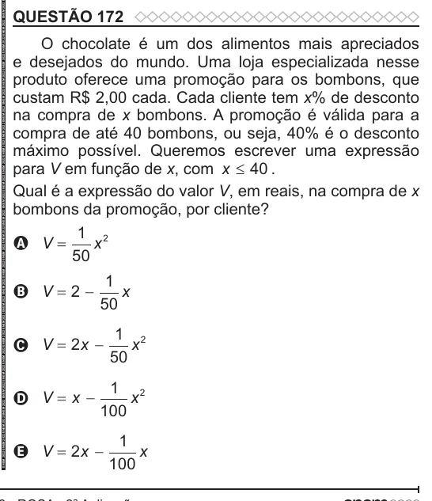

Texto extraído (pode conter ruído)

QUESTÃO 172  
O chocolate é um dos alimentos mais apreciados  
e desejados do mundo. Uma loja especializada nesse  
produto oferece uma promoção para os bombons, que  
custam R$ 2,00 cada. Cada cliente tem x% de desconto  
na compra de x bombons. A promoção é válida para a  
compra de até 40 bombons, ou seja, 40% é o desconto  
máximo possível. Queremos escrever uma expressão  
para V em função de x, com x ≤ 40 .  
Qual é a expressão do valor V, em reais, na compra de x  
bombons da promoção, por cliente?  
1 2  
A V =  
x  
50  
1  
B V  2   
x  
50  
1 2  
C V  2 x   
x  
50  
1 2  
D V  x   
x  
100  
1  
E V  2 x   
x  
100

