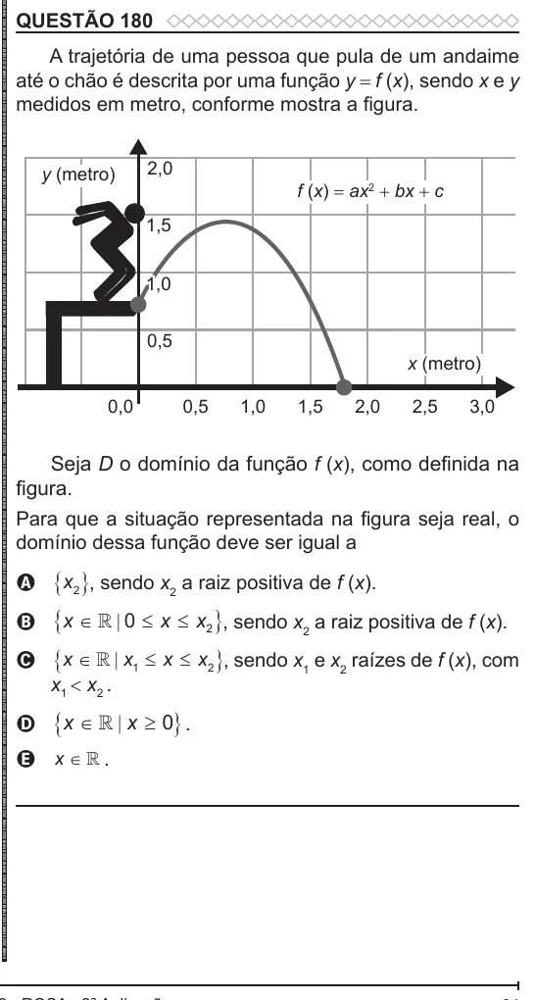

Texto extraído (pode conter ruído)

QUESTÃO 180  
A trajetória de uma pessoa que pula de um andaime  
até o chão é descrita por uma função y = f (x), sendo x e y  
medidos em metro, conforme mostra a figura.  
2,0  
y (metro)  
f (x) = ax 2 + bx + c  
1,5  
1,0  
0,5  
x (metro)  
0,0  
0,5  
1,0  
1,5  
2,0  
2,5  
3,0  
Seja D o domínio da função f (x) , como definida na  
figura.  
Para que a situação representada na figura seja real, o  
domínio dessa função deve ser igual a  
 x 2  , sendo x 2 a raiz positiva de f (x).  
A  
B  x    0  x  x 2  , sendo x 2 a raiz positiva de f (x).  
C  x    x 1  x  x 2  , sendo x 1 e x 2 raízes de f (x), com  
x 1 < x 2 .  
 x    x  0  .  
D  
E x ∈  .

