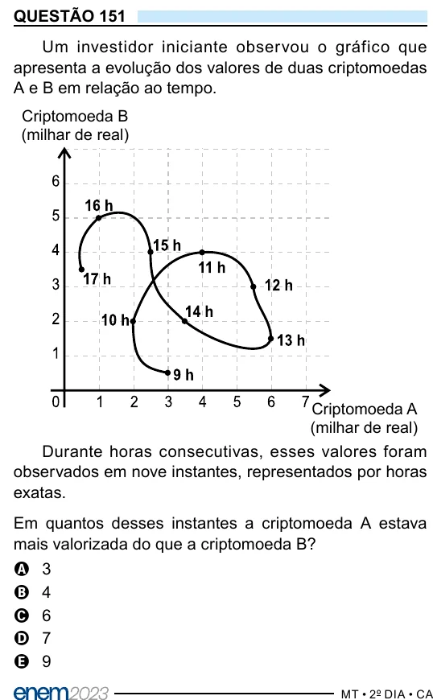

Texto extraído (pode conter ruído)

QUESTÃO 151  
Um investidor iniciante observou o gráfico que  
apresenta a evolução dos valores de duas criptomoedas  
A e B em relação ao tempo.  
Criptomoeda B  
(milhar de real)  
Criptomoeda A  
(milhar de real)  
Durante horas consecutivas, esses valores foram  
observados em nove instantes, representados por horas  
exatas.  
Em quantos desses instantes a criptomoeda A estava  
mais valorizada do que a criptomoeda B?  
A  
3  
4  
B  
6  
C  
7  
D  
9  
E

