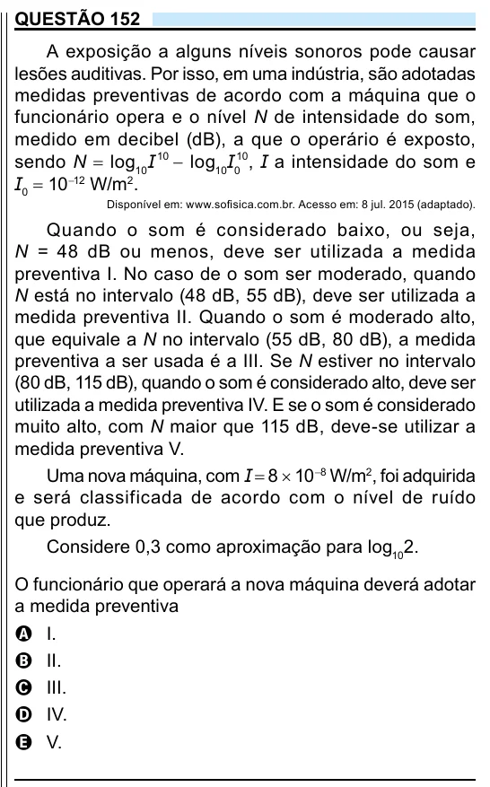

Texto extraído (pode conter ruído)

QUESTÃO 152  
A exposição a alguns níveis sonoros pode causar  
lesões auditivas. Por isso, em uma indústria, são adotadas  
medidas preventivas de acordo com a máquina que o  
funcionário opera e o nível N de intensidade do som,  
medido em decibel (dB), a que o operário é exposto,  
sendo N = log 10 I 10 − log 10 I 0 10 , I a intensidade do som e  
I 0 = 10 −12 W/m 2 .  
Disponível em: www.sofisica.com.br. Acesso em: 8 jul. 2015 (adaptado).  
Quando o som é considerado baixo, ou seja,  
N = 48 dB ou menos, deve ser utilizada a medida  
preventiva I. No caso de o som ser moderado, quando  
N está no intervalo (48 dB, 55 dB), deve ser utilizada a  
medida preventiva II. Quando o som é moderado alto,  
que equivale a N no intervalo (55 dB, 80 dB), a medida  
preventiva a ser usada é a III. Se N estiver no intervalo  
(80 dB, 115 dB), quando o som é considerado alto, deve ser  
utilizada a medida preventiva IV. E se o som é considerado  
muito alto, com N maior que 115 dB, deve-se utilizar a  
medida preventiva V.  
Uma nova máquina, com I = 8 × 10 −8 W/m 2 , foi adquirida  
e será classificada de acordo com o nível de ruído  
que produz.  
Considere 0,3 como aproximação para log 10 2.  
O funcionário que operará a nova máquina deverá adotar  
a medida preventiva  
A I.  
B II.  
C III.  
D IV.  
E V.

