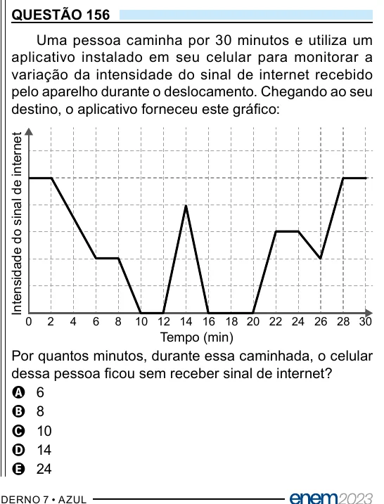

Texto extraído (pode conter ruído)

QUESTÃO 156  
Uma pessoa caminha por 30 minutos e utiliza um  
aplicativo instalado em seu celular para monitorar a  
variação da intensidade do sinal de internet recebido  
pelo aparelho durante o deslocamento. Chegando ao seu  
destino, o aplicativo forneceu este gráfico:  
Intensidade do sinal de internet  
0  
2  
4  
6  
8  
10 12 14 16 18 20 22 24 26 28 30  
Tempo (min)  
Por quantos minutos, durante essa caminhada, o celular  
dessa pessoa ficou sem receber sinal de internet?  
A 6  
B 8  
C 10  
D 14  
E 24

