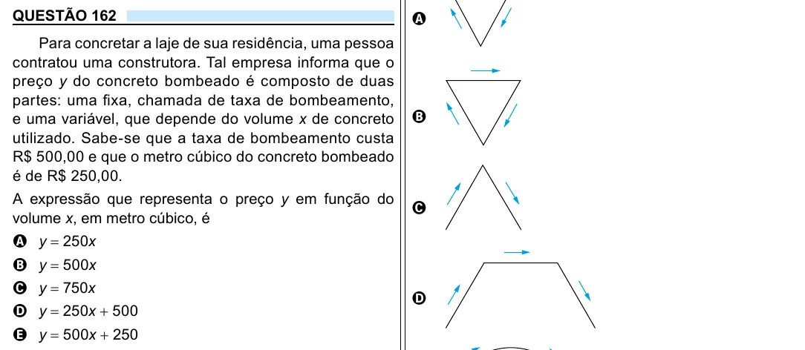

Texto extraído (pode conter ruído)

QUESTÃO 162  
A  
Para concretar a laje de sua residência, uma pessoa  
contratou uma construtora. Tal empresa informa que o  
preço y do concreto bombeado é composto de duas  
partes: uma fixa, chamada de taxa de bombeamento,  
e uma variável, que depende do volume x de concreto  
B  
utilizado. Sabe-se que a taxa de bombeamento custa  
R$ 500,00 e que o metro cúbico do concreto bombeado  
é de R$ 250,00.  
A expressão que representa o preço y em função do  
C  
volume x, em metro cúbico, é  
A y = 250x  
B y = 500x  
C y = 750x  
D  
D y = 250x + 500  
E y = 500x + 250

