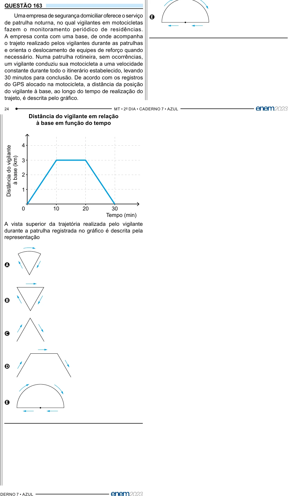

Texto extraído (pode conter ruído)

QUESTÃO 163  
Uma empresa de segurança domiciliar oferece o serviço  
E  
de patrulha noturna, no qual vigilantes em motocicletas  
fazem o monitoramento periódico de residências.  
A empresa conta com uma base, de onde acompanha  
o trajeto realizado pelos vigilantes durante as patrulhas  
e orienta o deslocamento de equipes de reforço quando  
necessário. Numa patrulha rotineira, sem ocorrências,  
um vigilante conduziu sua motocicleta a uma velocidade  
constante durante todo o itinerário estabelecido, levando  
30 minutos para conclusão. De acordo com os registros  
do GPS alocado na motocicleta, a distância da posição  
do vigilante à base, ao longo do tempo de realização do  
trajeto, é descrita pelo gráfico.  
Distância do vigilante em relação  
à base em função do tempo  
4  
Distância do vigilante  
à base (km)  
3  
2  
1  
0  
10  
20  
30  
Tempo (min)  
A vista superior da trajetória realizada pelo vigilante  
durante a patrulha registrada no gráfico é descrita pela  
representação  
A  
B  
C  
D  
E

