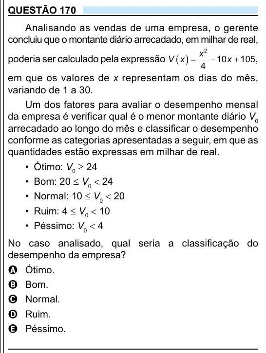

Texto extraído (pode conter ruído)

QUESTÃO 170  
Analisando as vendas de uma empresa, o gerente  
concluiu que o montante diário arrecadado, em milhar de real,  
x 2  
poderia ser calculado pela expressão V  x    
 10 x  105 ,  
4  
em que os valores de x representam os dias do mês,  
variando de 1 a 30.  
Um dos fatores para avaliar o desempenho mensal  
da empresa é verificar qual é o menor montante diário V 0  
arrecadado ao longo do mês e classificar o desempenho  
conforme as categorias apresentadas a seguir, em que as  
quantidades estão expressas em milhar de real.  
• Ótimo: V 0 ≥ 24  
• Bom: 20 ≤ V 0 < 24  
• Normal: 10 ≤ V 0 < 20  
• Ruim: 4 ≤ V 0 < 10  
• Péssimo: V 0 < 4  
No caso analisado, qual seria a classificação do  
desempenho da empresa?  
A Ótimo.  
B Bom.  
C Normal.  
D Ruim.  
E Péssimo.

