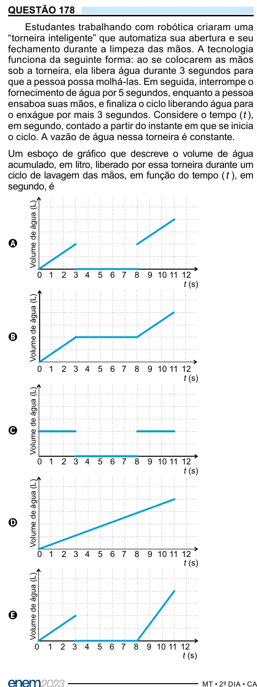

Texto extraído (pode conter ruído)

QUESTÃO 178  
Estudantes trabalhando com robótica criaram uma  
“torneira inteligente” que automatiza sua abertura e seu  
fechamento durante a limpeza das mãos. A tecnologia  
funciona da seguinte forma: ao se colocarem as mãos  
sob a torneira, ela libera água durante 3 segundos para  
que a pessoa possa molhá-las. Em seguida, interrompe o  
fornecimento de água por 5 segundos, enquanto a pessoa  
ensaboa suas mãos, e finaliza o ciclo liberando água para  
o enxágue por mais 3 segundos. Considere o tempo ( t ),  
em segundo, contado a partir do instante em que se inicia  
o ciclo. A vazão de água nessa torneira é constante.  
Um esboço de gráfico que descreve o volume de água  
acumulado, em litro, liberado por essa torneira durante um  
ciclo de lavagem das mãos, em função do tempo ( t ), em  
segundo, é  
Volume de água (L)  
A  
0 1 2 3 4 5 6 7 8 9 10 11 12  
t (s)  
Volume de água (L)  
B  
0 1 2 3 4 5 6 7 8 9 10 11 12  
t (s)  
Volume de água (L)  
C  
0 1 2 3 4 5 6 7 8 9 10 11 12  
t (s)  
Volume de água (L)  
D  
0 1 2 3 4 5 6 7 8 9 10 11 12  
t (s)  
Volume de água (L)  
E  
0  
1 2 3 4 5 6 7 8 9 10 11 12  
t (s)

